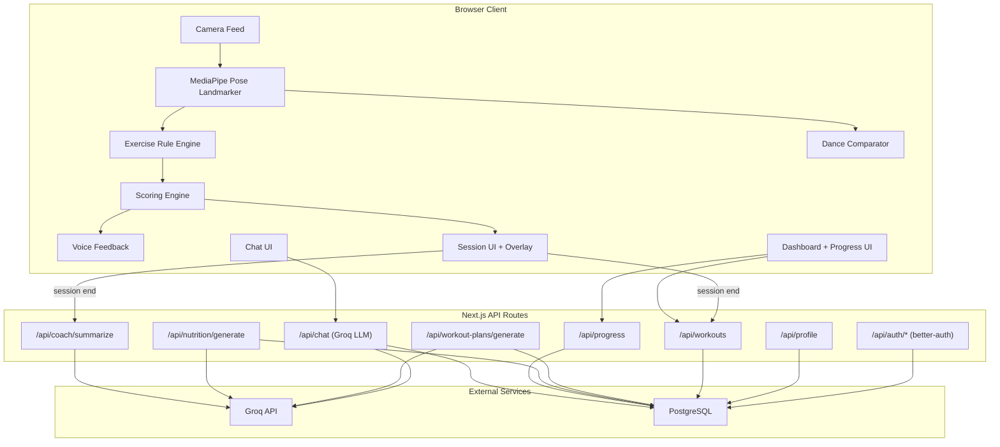

# AI Fitness and Dance Coach -- Full Implementation Plan

## Current State Summary

The existing project is a **Next.js 15 (App Router)** app with:
- **Working**: Basic MediaPipe pose detection in browser, OpenAI chat (gpt-4o-mini), Drizzle schema with SQLite, shadcn/radix UI, seed data for exercises/achievements/dance styles, multi-step onboarding UI
- **Broken/Disconnected**: better-auth configured but **never wired to the UI** (no login page, no session usage), user identity is random `localStorage` IDs
- **Mocked/Stub**: Dashboard stats, progress history, achievements, workout plans, nutrition plans all use **hardcoded mock arrays or localStorage** -- not backed by the database
- **Missing Entirely**: Professional scoring model, exercise-specific rule engines, dance pose comparison, voice feedback, Groq LLM integration, workout plan generation, diet plan generation, real progress tracking, session summaries, dual feedback system

---

## Gap Analysis (Knowledge Base vs. Current)

| KB Module | Current State | Gap |
|-----------|--------------|-----|
| 3.1 Live Pose Analysis | MediaPipe runs client-side, basic angle heuristics | No state-machine rep counting, no ROM/tempo/stability/symmetry scoring |
| 3.2 Exercise Coaching | PoseAnalyzer has presets for ~4 exercises | No per-exercise rule engine with full form checks from KB section 8 |
| 3.3 Dance Coaching | UI page exists, dance styles seeded | No reference routine playback, no pose comparison, no timing/segment scoring |
| 3.4 AI Chat Coach | OpenAI chat works, persists messages | Not using Groq, no structured onboarding Q&A, no session-aware coaching |
| 3.5 Workout Planning | Mock plans in UI | No AI generation, no progression logic, no weekly splits |
| 3.6 Diet Planning | Nutrition page with mock data | No AI meal generation, no macro calculation, no personalization |
| 3.7 Progress Dashboard | Mock arrays, localStorage | No real DB-backed tracking, no trend analysis, no coaching summaries |
| 3.8 Voice/UX Feedback | Not implemented | No browser speech synthesis, no rate-limited voice cues |
| Auth | better-auth configured, not used | No login/signup pages, no session-gated routes |
| Database | SQLite + Drizzle schema exists | Schema is good but pages bypass it for localStorage/mocks |
| Backend | Express stub returning hardcoded JSON | No real analysis, no LLM orchestration, no plan generation endpoints |

---

## Phase 1: Foundation (Auth, DB Wiring, Profile Sync)

**Goal**: Every user has a real identity; all data flows through the database, not localStorage.

### 1A. Wire Authentication to UI
- Create `/login` and `/signup` pages using better-auth's `signIn.email` / `signUp.email` from [src/lib/auth/client.ts](src/lib/auth/client.ts)
- Add Next.js middleware (`src/middleware.ts`) to protect `/dashboard`, `/coach/*`, `/workouts`, `/nutrition`, `/progress`, `/achievements`, `/settings` -- redirect unauthenticated users to `/login`
- Update [src/components/layout/AppLayout.tsx](src/components/layout/AppLayout.tsx): show real user name/email from `useSession()`, wire "Log out" to `signOut()`
- Update the landing page (`/`) to be a public marketing page; authenticated users redirect to `/dashboard`

### 1B. Sync Profile with Database
- Replace `useUserProfile` localStorage hook with a React context/hook that reads/writes from `POST /api/profile` and `GET /api/profile`
- Pass the real `session.user.id` (from better-auth) to all API calls instead of `localStorage` random IDs
- Update [src/app/onboarding/page.tsx](src/app/onboarding/page.tsx) to POST profile to DB on completion
- Update [src/app/settings/page.tsx](src/app/settings/page.tsx) to read/write from the same API

### 1C. Replace All Mock Data with DB Queries
- **Dashboard** ([src/app/dashboard/page.tsx](src/app/dashboard/page.tsx)): Replace mock weekly data, heatmap, streak with real queries from `workout_sessions`, `progress_tracking`
- **Progress** ([src/app/progress/page.tsx](src/app/progress/page.tsx)): Replace `mockWeightHistory` etc. with real `progress_tracking` rows
- **Achievements** ([src/app/achievements/page.tsx](src/app/achievements/page.tsx)): Replace `mockAchievements` with `user_achievements` join query
- **Workout Plans** ([src/app/workout-plans/page.tsx](src/app/workout-plans/page.tsx)): Replace mock plans with `workout_plans` from DB
- **Nutrition** ([src/app/nutrition/page.tsx](src/app/nutrition/page.tsx)): Wire to `nutrition_plans` + `food_log` tables

---

## Phase 2: Exercise Coaching Engine (Core Differentiator)

**Goal**: Professional-grade, per-exercise rule engines with composite scoring.

### 2A. Exercise State Machine + Rep Counter
- Refactor [src/components/PoseAnalyzer.tsx](src/components/PoseAnalyzer.tsx) into a modular architecture:
  - `src/lib/pose/` -- shared types, angle utilities, landmark helpers
  - `src/lib/pose/exercises/bicep-curl.ts` -- state machine, phase detection, form checks per KB 8.2
  - `src/lib/pose/exercises/push-up.ts` -- per KB 8.1
  - `src/lib/pose/exercises/jumping-jack.ts` -- per KB 8.3
  - `src/lib/pose/exercises/lunges.ts` -- per KB 8.4
- Each exercise module exports: `detectPhase()`, `countRep()`, `evaluateForm()`, `getCorrections()`
- State machine pattern: IDLE -> DOWN_PHASE -> BOTTOM -> UP_PHASE -> TOP -> rep counted

### 2B. Professional Scoring Model (KB Section 9)
- Create `src/lib/pose/scoring.ts` implementing composite scoring:
  - **Form accuracy** (joint angles vs ideal ranges)
  - **Range of motion** (actual vs target ROM percentage)
  - **Tempo control** (phase duration consistency)
  - **Stability** (landmark jitter/sway during holds)
  - **Symmetry** (left vs right side comparison)
  - **Consistency** (rep-to-rep variance)
  - **Endurance/fatigue** (score degradation over set)
  - **Safety** (dangerous angle thresholds)
- Configurable per-exercise weights as described in KB section 9
- Final score: weighted average, 0-100

### 2C. Dual Feedback System (KB Section 10)
- **Rule-based layer**: Immediate, deterministic corrections ("Straighten your back", "Lower deeper") emitted by exercise modules
- **LLM layer**: After every N reps or end-of-set, send accumulated metrics to Groq API for natural-language coaching interpretation
- Priority logic: safety corrections always override motivational feedback
- Create `src/lib/feedback/rule-engine.ts` and `src/lib/feedback/llm-coach.ts`

---

## Phase 3: Dance Coaching Module

**Goal**: One dance style (hip-hop beginner) with pose comparison and scoring.

### 3A. Reference Routine System
- Store reference routines as timed arrays of landmark snapshots (JSON) in `dance_styles` or a new `dance_routines` table
- Create a routine player component that shows reference poses at timed intervals
- Segment routines into checkpoints (pose + timestamp)

### 3B. Pose Comparison Engine
- Create `src/lib/pose/dance/comparator.ts`:
  - Normalize landmarks to body-relative coordinates
  - Compute cosine similarity between user pose and reference pose per checkpoint
  - Score timing alignment (how close user hits the pose to the checkpoint time)
  - Detect missed transitions
- Segment-wise feedback + overall dance performance score

### 3C. Dance Session UI
- Update [src/app/coach/dance/page.tsx](src/app/coach/dance/page.tsx):
  - Side-by-side or overlay view: reference routine + user camera
  - Real-time pose similarity indicator
  - Segment progress bar
  - Post-routine score breakdown

---

## Phase 4: AI Chat Coach + LLM Integration

**Goal**: Context-aware conversational coach using Groq API.

### 4A. Switch to Groq API
- Replace OpenAI in [src/app/api/chat/route.ts](src/app/api/chat/route.ts) with Groq SDK (`groq-sdk` package)
- Use `llama-3.3-70b-versatile` or similar fast model for conversational coaching
- Add `GROQ_API_KEY` to `.env.example`

### 4B. Deep Context System Prompt
- Build a rich system prompt that includes: user profile (goals, injuries, fitness level, equipment), recent session scores, workout plan adherence, progress trends
- The coach should be able to: explain mistakes, suggest modifications for injuries, motivate, summarize progress, answer fitness/diet questions

### 4C. Structured Onboarding via Chat
- If user hasn't completed onboarding, the chat coach drives structured Q&A to collect profile data (KB section 12)
- Responses are parsed and saved to `user_profiles`
- This provides an alternative to the form-based onboarding

### 4D. Session-Aware Coaching
- After workout sessions, auto-generate a coaching summary
- Chat can reference specific session data ("Your form dropped on rep 8, focus on...")
- Create `POST /api/coach/summarize` endpoint for post-session LLM analysis

---

## Phase 5: Workout + Diet Plan Generation

**Goal**: AI-generated personalized plans, not mock data.

### 5A. Workout Plan Generation
- Create `POST /api/workout-plans/generate` endpoint
- Input: user profile (goals, fitness level, injuries, equipment, available time, intensity preference)
- LLM generates: weekly split, daily exercises, sets/reps/rest, warm-up, cool-down
- Output stored in `workout_plans` + associated `workout_exercises`
- Support progression rules (increase weight/reps weekly) and regression (pain/low fitness)

### 5B. Diet Plan Generation
- Create `POST /api/nutrition/generate` endpoint
- Input: goal, body profile, injuries, activity level, budget, cuisine preferences, allergies, dietary restrictions
- LLM generates: daily meal ideas, macro targets, hydration advice, meal timing
- Output stored in `nutrition_plans`
- Focus on sustainable, realistic suggestions per KB section 15

### 5C. Plan Adaptation
- Plans should be re-generatable based on updated profile or progress
- Weekly check-in prompt from coach to adjust plans

---

## Phase 6: Voice Feedback + Real-Time UX

**Goal**: Voice-based coaching cues during live sessions.

### 6A. Browser Speech Synthesis
- Implement `src/lib/feedback/voice.ts` using `window.speechSynthesis` API
- Rate-limit voice cues (max one every 3-5 seconds) to avoid overload
- Priority queue: safety > form correction > encouragement > rep count

### 6B. Session Overlay UX
- Enhance the workout session UI ([src/app/coach/workout/page.tsx](src/app/coach/workout/page.tsx)):
  - Skeleton overlay on camera feed (already partially done)
  - Real-time score gauge
  - Rep counter with form quality indicator per rep
  - Text overlay for current correction
  - Timer + rest period indicator
  - Voice on/off toggle

### 6C. Session Persistence
- On session end, POST full session data to `/api/workouts`:
  - Per-rep scores, corrections triggered, composite score breakdown
  - Duration, exercise sequence, fatigue curve
- Generate and store session summary via LLM

---

## Phase 7: Progress Tracking + Coaching Memory

**Goal**: Longitudinal tracking with trend analysis and coaching context.

### 7A. Progress APIs
- Create proper `GET/POST /api/progress` endpoints backed by `progress_tracking` table
- Track: weight, measurements, workout frequency, average scores per exercise, streaks

### 7B. Dashboard with Real Data
- [src/app/dashboard/page.tsx](src/app/dashboard/page.tsx): Real streak calculation from `workout_sessions`
- Weekly/monthly charts from `recharts` using actual session data
- Score trend lines per exercise
- Adherence percentage (planned vs completed workouts)

### 7C. Achievement System
- Create achievement evaluation logic (e.g., "Complete 10 workouts", "Score 90+ on push-ups")
- Auto-award achievements after sessions via `user_achievements` table
- Display real badges on `/achievements`

### 7D. Coaching Memory
- Store chat summaries and key coaching decisions in `chat_sessions`
- LLM system prompt includes recent coaching history for continuity
- Progress milestones trigger proactive coach messages

---

## Phase 8: Production Hardening

**Goal**: Production-ready quality, security, and performance.

### 8A. Database Migration to PostgreSQL
- Switch from SQLite to PostgreSQL (Neon, Supabase, or self-hosted)
- Update `drizzle.config.ts` and schema to use `pg-core` instead of `sqlite-core`
- Migrate seed data

### 8B. Backend Consolidation
- Remove the Express stub in `/backend`
- All server logic lives in Next.js API routes (or migrate to a FastAPI backend if preferred for heavier ML tasks later)
- The `/api/analyze` proxy can be removed; analysis runs client-side

### 8C. Security + Privacy
- Camera permissions handled gracefully with clear privacy messaging
- No raw video stored; only pose landmarks persisted
- Rate-limit API routes
- Input validation (Zod) on all API endpoints
- CSRF protection (already has `CSRF_SECRET` in env)

### 8D. Performance + Resilience
- Handle low FPS gracefully (reduce landmark detection frequency)
- Lazy-load MediaPipe models
- Skeleton rendering at reduced fidelity on weak devices
- Error boundaries for camera/pose failures
- Offline-capable session (queue data for sync)

### 8E. UI Polish
- Responsive design audit across mobile/tablet/desktop
- Loading states, empty states, error states for all pages
- Consistent theme (dark/light mode already partially implemented)
- Accessibility audit (keyboard navigation, screen reader support)

---

## Architecture Diagram

---

## Recommended Implementation Order

Phases 1 through 4 are the **critical path** -- they establish the authenticated, data-driven, AI-coached foundation. Phases 5-7 layer on generated content and tracking. Phase 8 is the production polish pass.

**Estimated scope**: ~35-45 files modified/created across all phases. The existing Drizzle schema already covers most tables needed; the main work is in the pose engine modules, API route logic, LLM integration, and replacing mocks with real data flows.
