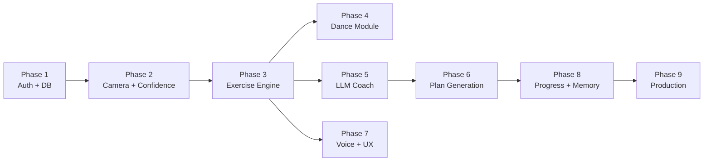

# AI Fitness and Dance Coach -- Full Implementation Plan (V2)

This is the upgraded plan incorporating all 10 review feedback items. Changes from V1 are marked with **[NEW]** or **[UPGRADED]**.

---

## Current State Summary

The existing project is a **Next.js 15 (App Router)** app with:
- **Working**: Basic MediaPipe pose detection in browser, OpenAI chat (gpt-4o-mini), Drizzle schema with SQLite, shadcn/radix UI, seed data for exercises/achievements/dance styles, multi-step onboarding UI
- **Broken/Disconnected**: better-auth configured but **never wired to the UI** (no login page, no session usage), user identity is random `localStorage` IDs
- **Mocked/Stub**: Dashboard stats, progress history, achievements, workout plans, nutrition plans all use **hardcoded mock arrays or localStorage** -- not backed by the database
- **Missing Entirely**: Professional scoring model, exercise-specific rule engines, dance pose comparison, voice feedback, Groq LLM integration, workout plan generation, diet plan generation, real progress tracking, session summaries, dual feedback system, camera calibration, pose confidence handling, safety engine

---

## Architecture Decision: Backend Strategy **[NEW]**

**Decision: Keep everything in Next.js API routes for V1. Plan extraction later.**

Rationale:
- The product's real-time loop (pose analysis, scoring, feedback) runs entirely in the browser -- the backend is NOT in the hot path for live coaching
- Backend handles only: auth, CRUD, LLM orchestration (Groq calls), plan generation, session persistence
- These are all standard request-response patterns that Next.js Route Handlers handle well
- Extracting to FastAPI later makes sense only if we add: batch video analysis, multimodal model inference, or heavy async job queues

Action items:
- Remove the Express stub in [backend/server.js](backend/server.js) entirely
- Remove the `/api/analyze` proxy route in [src/app/api/analyze/route.ts](src/app/api/analyze/route.ts)
- All analysis runs client-side; LLM feedback goes through `/api/coach/feedback`

---

## Phase 1: Foundation (Auth, DB Wiring, Profile Sync)

**Goal**: Every user has a real identity; all data flows through the database, not localStorage.

### 1A. Wire Authentication to UI
- Create `/login` and `/signup` pages using better-auth's `signIn.email` / `signUp.email` from [src/lib/auth/client.ts](src/lib/auth/client.ts)
- Add Next.js middleware (`src/middleware.ts`) to protect `/dashboard`, `/coach/*`, `/workouts`, `/nutrition`, `/progress`, `/achievements`, `/settings`
- Update [src/components/layout/AppLayout.tsx](src/components/layout/AppLayout.tsx): real user name from `useSession()`, wire "Log out" to `signOut()`
- Landing page (`/`) becomes public; authenticated users redirect to `/dashboard`

### 1B. Sync Profile with Database
- Replace `useUserProfile` localStorage hook ([src/hooks/useUserProfile.ts](src/hooks/useUserProfile.ts)) with a React context that reads/writes via `GET/POST /api/profile`
- Pass `session.user.id` to all API calls instead of `localStorage` random IDs
- Update onboarding and settings pages to POST to DB on save

### 1C. Replace All Mock Data with DB Queries
- **Dashboard**: Replace mock weekly data, heatmap, streak with real `workout_sessions` queries
- **Progress**: Replace `mockWeightHistory` with real `progress_tracking` rows
- **Achievements**: Replace mock with `user_achievements` join query
- **Workout Plans**: Replace mock plans with `workout_plans` from DB
- **Nutrition**: Wire to `nutrition_plans` + `food_log` tables

---

## Phase 2: Camera Calibration + Pose Confidence Layer **[NEW]**

**Goal**: Ensure pose data quality before exercise analysis begins. This phase is a prerequisite for accurate scoring.

### 2A. Pre-Session Camera Calibration
Add a setup screen in [src/components/PoseAnalyzer.tsx](src/components/PoseAnalyzer.tsx) (or a new `SessionSetup` component) that runs BEFORE exercise analysis starts:

- **Full-body visibility check**: Verify all 33 MediaPipe landmarks detected with confidence > 0.6
- **Lighting adequacy**: Check average landmark confidence across 10 frames; warn if < 0.65
- **Distance guidance**: Measure ratio of shoulder-width to frame-width; guide "step back" / "step closer"
- **Camera angle guidance per exercise**:
  - Push-ups: side view preferred (detect via shoulder-hip-ankle horizontal alignment)
  - Squats/lunges/jumping jacks: front-facing full-body
  - Dance: front-facing full-body, minimum 80% body visibility
- **Left/right orientation normalization**: Detect which side faces camera; mirror landmark mapping if needed
- **Ready gate**: Session starts only when all checks pass for 3+ consecutive seconds

### 2B. Runtime Pose Confidence and Error Handling **[NEW]**
Create `src/lib/pose/confidence.ts`:

- **Landmark confidence too low** (avg < 0.5 for 1s): pause scoring, show "Adjust your position" overlay
- **Body partially out of frame** (key landmarks missing): suspend rep counting, preserve rep state, show "Step back into frame"
- **Camera lost** (no video frames for > 2s): show recovery prompt with "Reconnect Camera" button
- **Jitter detection**: Apply exponential moving average (EMA) smoothing on landmark positions before passing to rule engines; configurable alpha (0.3 default)
- **FPS degradation** (< 15 fps for 5s): reduce model complexity from 1 to 0, notify user

These checks wrap the existing `pose.onResults` callback and gate whether landmarks are forwarded to the exercise rule engine.

---

## Phase 3: Exercise Coaching Engine **[UPGRADED]**

**Goal**: Professional-grade, per-exercise rule engines with tiered scoring.

### 3A. Exercise State Machine + Rep Counter
Refactor [src/components/PoseAnalyzer.tsx](src/components/PoseAnalyzer.tsx) (currently 1400 lines, monolithic) into:

- `src/lib/pose/types.ts` -- shared types, `ExerciseLandmarks`, `RepEvent`, `FormCheck`
- `src/lib/pose/angles.ts` -- extract existing `calculateAngle`, add `calculateDistance`, `calculateSlope`
- `src/lib/pose/exercises/bicep-curl.ts` -- KB 8.2: elbow stability, shoulder compensation, full contraction/extension, wrist control, tempo symmetry, body swinging
- `src/lib/pose/exercises/push-up.ts` -- KB 8.1: back alignment, elbow angle, chest depth, head/neck, pace, lockout, incomplete reps, asymmetry
- `src/lib/pose/exercises/jumping-jack.ts` -- KB 8.3: arm raise height, leg spread, coordination, rhythm, landing control, torso stability
- `src/lib/pose/exercises/lunges.ts` -- KB 8.4: knee alignment, knee travel, rear knee depth, torso posture, step length, balance, left-right asymmetry

Each module exports:

```typescript
interface ExerciseEngine {
  detectPhase(landmarks: NormalizedLandmark[]): ExercisePhase;
  countRep(prevPhase: ExercisePhase, currentPhase: ExercisePhase): RepEvent | null;
  evaluateForm(landmarks: NormalizedLandmark[]): FormCheckResult[];
  getCorrections(formChecks: FormCheckResult[]): Correction[];
  cameraRequirement: CameraPosition; // "front" | "side" | "front_preferred"
}
```

State machine: `IDLE -> ECCENTRIC -> BOTTOM -> CONCENTRIC -> TOP -> rep counted`

### 3B. Tiered Scoring Model **[UPGRADED from flat to tiered per review item 3]**

Create `src/lib/pose/scoring.ts` with three scoring granularities:

**Live (every frame, < 16ms budget):**
- Posture warnings (safety thresholds exceeded)
- Current exercise phase indicator
- Safety alerts (dangerous angles)

**Per-Rep (computed on rep completion):**
- Form accuracy score (joint angles vs ideal ranges per exercise)
- Range of motion score (actual vs target ROM percentage)
- Tempo score (phase duration vs target duration)

**Per-Set / Per-Session (computed on set/session end):**
- Consistency score (rep-to-rep variance in form, ROM, tempo)
- Symmetry score (left vs right comparison, averaged across reps)
- Endurance/fatigue degradation (score trend from first rep to last)
- Stability score (landmark jitter averaged across set)

Composite score formula per exercise (configurable weights):

```typescript
interface ExerciseWeights {
  form: number;      // default 0.25
  rom: number;       // default 0.20
  tempo: number;     // default 0.15
  stability: number; // default 0.10
  symmetry: number;  // default 0.10
  consistency: number; // default 0.10
  safety: number;    // default 0.10
}
```

### 3C. Safety and Contraindication Engine **[NEW per review item 6]**

Create `src/lib/pose/safety.ts`:

- **Injury-aware exercise filtering**: Before session start, check user profile injuries against exercise contraindications
  - Knee injury -> warn/block lunges, reduce squat ROM target
  - Shoulder injury -> warn/block push-ups, suggest wall push-ups
  - Back injury -> reduce all forward-lean tolerance thresholds
- **Live safety rules** (highest priority, override all other feedback):
  - Knee valgus (inward collapse) > 15 degrees: immediate "Stop - knees collapsing inward"
  - Hyperextension of any joint beyond safe threshold: immediate warning
  - Neck hyperextension during push-ups: immediate "Look at the floor"
- **Regression suggestions**: When user scores < 50 on safety for 3+ reps, suggest easier modification from `exercises.modifications` JSON
- **ROM target adjustment**: For users with injuries, automatically reduce target ROM by configurable percentage

### 3D. Dual Feedback System
- **Rule-based layer** (`src/lib/feedback/rule-engine.ts`): Immediate, deterministic corrections from exercise modules
- **LLM layer** (`src/lib/feedback/llm-coach.ts`): After every N reps or end-of-set, send metrics to Groq for natural coaching
- Priority: safety > posture correction > form guidance > motivation > rep count announcement

---

## Phase 4: Dance Coaching Module **[UPGRADED]**

**Goal**: One dance style (hip-hop beginner) with pose comparison and scoring.

### 4A. Reference Routine Data Pipeline **[NEW clarity per review item 5]**

**Decision: Handcrafted from recorded video.**

Pipeline:
1. Record a choreographer performing the routine with the same MediaPipe setup
2. Extract landmark snapshots at 10fps using a utility script (`scripts/extract-dance-landmarks.ts`)
3. Segment into timed checkpoints (pose + timestamp) manually via a simple editor UI or JSON editing
4. Store as curated JSON assets in `public/routines/hip-hop-beginner.json`
5. Reference in `dance_routines` table (new table, see schema section)

This avoids needing an admin UI for V1 while keeping the data format clean for future expansion.

### 4B. Pose Comparison Engine
Create `src/lib/pose/dance/comparator.ts`:
- Normalize landmarks to body-relative coordinates (hip-center origin, shoulder-width scale)
- Cosine similarity between user pose vector and reference pose vector per checkpoint
- Timing alignment score (how close user hits the pose to the checkpoint timestamp)
- Missed transition detection (similarity drops below 0.4 for > 2 seconds)
- Segment-wise feedback + overall dance score

### 4C. Dance Session UI
Update [src/app/coach/dance/page.tsx](src/app/coach/dance/page.tsx):
- Side-by-side: reference skeleton animation + user camera
- Real-time similarity gauge
- Segment progress bar with checkpoint markers
- Post-routine score breakdown by segment

---

## Phase 5: AI Chat Coach + LLM Integration

**Goal**: Context-aware conversational coach using Groq API.

### 5A. Switch to Groq API
- Replace OpenAI in [src/app/api/chat/route.ts](src/app/api/chat/route.ts) with `groq-sdk`
- Model: `llama-3.3-70b-versatile` (fast, good for conversation)
- Add `GROQ_API_KEY` to `.env.example`

### 5B. Deep Context System Prompt **[UPGRADED]**
Build system prompt from: user profile, last 3 session scores, current workout plan adherence %, recent injuries/pain reported, progress trends (weight change, score improvement)

### 5C. Structured Onboarding via Chat
If `onboardingCompleted === false`, chat drives structured Q&A for KB section 12 inputs. Parsed responses saved to `user_profiles`.

### 5D. Session-Aware Coaching
- Post-session: auto-generate coaching summary via `POST /api/coach/summarize`
- Chat references specific session data ("Your form dropped on rep 8...")
- Coaching memory stored in `chat_sessions.summary` field (new column)

---

## Phase 6: Workout + Diet Plan Generation **[UPGRADED]**

### 6A. Workout Plan Generation
`POST /api/workout-plans/generate` -- see API contracts section below for full spec.

### 6B. Diet Plan Generation **[UPGRADED with structured output per review item 7]**

`POST /api/nutrition/generate` -- LLM generates structured JSON (not free text):

```typescript
interface GeneratedNutritionPlan {
  dailyCalories: number;
  macros: { proteinGrams: number; carbsGrams: number; fatGrams: number };
  meals: {
    type: "breakfast" | "lunch" | "dinner" | "snack";
    name: string;
    ingredients: string[];
    calories: number;
    protein: number;
    carbs: number;
    fat: number;
    prepTime: number; // minutes
    budgetTier: "low" | "medium" | "high";
    cuisineTag: string; // "indian", "mediterranean", etc.
  }[];
  hydration: { dailyLiters: number; reminders: string[] };
  groceryList: { item: string; quantity: string; estimatedCost: string }[];
  mealTimingAdvice: string;
  notes: string; // sustainability tips, substitution ideas
}
```

The LLM is prompted with a JSON schema and `response_format: { type: "json_object" }` to ensure parseable output. Stored in `nutrition_plans.meals` JSON column.

### 6C. Plan Adaptation
- Weekly coach check-in prompt to assess adherence and adjust
- Re-generate on profile/goal change

---

## Phase 7: Voice Feedback + Real-Time UX

### 7A. Browser Speech Synthesis
`src/lib/feedback/voice.ts` using `window.speechSynthesis`. Rate-limited to max one cue per 4 seconds. Priority queue: safety > correction > encouragement > rep count.

### 7B. Session Overlay UX **[UPGRADED with camera guidance per review item 2]**
Enhance [src/app/coach/workout/page.tsx](src/app/coach/workout/page.tsx):
- **Pre-session**: Camera position guide overlay showing ideal framing for selected exercise
- Skeleton overlay (existing, keep)
- Real-time score gauge + rep counter with per-rep quality dot (green/yellow/red)
- Text overlay for current correction
- Timer + rest period indicator
- Voice on/off toggle

### 7C. Session Persistence
On session end, POST to `/api/workouts` with full data (see API contracts).

---

## Phase 8: Progress Tracking + Coaching Memory

### 8A. Progress APIs
`GET/POST /api/progress` backed by `progress_tracking` table. Track: weight, measurements, workout frequency, avg scores per exercise, streaks.

### 8B. Dashboard with Real Data
Real streak calculation, weekly/monthly charts, score trends per exercise, adherence %.

### 8C. Achievement System
Auto-evaluate after sessions. Examples: "10 workouts completed", "90+ push-up score", "7-day streak".

### 8D. Coaching Memory
Store coaching summaries in `chat_sessions`. LLM prompt includes recent history. Milestones trigger proactive messages.

---

## Phase 9: Production Hardening

### 9A. Database: PostgreSQL Migration
Switch from SQLite to PostgreSQL (Neon recommended). Update `drizzle.config.ts` to `pg-core`. Migrate seed data.

### 9B. Security + Privacy
- Camera consent screen with clear privacy language ("Video never leaves your device")
- Only pose landmarks persisted, never raw video
- Zod validation on all API inputs
- Rate limiting on LLM endpoints (10 req/min per user)
- CSRF protection

### 9C. Performance + Resilience
- Graceful FPS degradation (reduce `modelComplexity`)
- Lazy-load MediaPipe models
- Error boundaries for camera failures
- Offline session queuing

### 9D. UI Polish
- Responsive across mobile/tablet/desktop
- Loading, empty, error states for every page
- Dark/light theme completion
- Accessibility audit

---

## Appendix A: Schema Definitions **[NEW per review item 8]**

### New Tables to Add

**`exercise_reps`** (new -- per-rep granular data)

```
id             text PK
sessionId      text FK -> workout_sessions.id
exerciseId     text FK -> exercises.id
repNumber      integer
phase          text           -- "eccentric", "concentric", "isometric"
formScore      integer        -- 0-100
romScore       integer        -- 0-100
tempoScore     integer        -- 0-100
safetyScore    integer        -- 0-100
corrections    text (JSON)    -- ["Keep back straight", "Lower deeper"]
durationMs     integer        -- time for this rep in ms
timestamps     text (JSON)    -- { startMs, bottomMs, endMs }
createdAt      timestamp
```

Read/write owner: session persistence (Phase 7C)

**`session_feedback_events`** (new -- timestamped feedback log)

```
id             text PK
sessionId      text FK -> workout_sessions.id
timestamp      integer        -- ms since session start
type           text           -- "safety", "form", "motivation", "llm"
message        text
severity       text           -- "critical", "warning", "info"
source         text           -- "rule_engine", "llm_coach"
createdAt      timestamp
```

Read/write owner: feedback engine during session

**`dance_routines`** (new -- reference routine data)

```
id             text PK
danceStyleId   text FK -> dance_styles.id
name           text
durationMs     integer
checkpoints    text (JSON)    -- [{ timestampMs, landmarks: [...], label }]
difficulty     text
musicUrl       text
thumbnailUrl   text
createdAt      timestamp
```

Read/write owner: admin/seed script; read by dance comparator

### Schema Modifications to Existing Tables

**`workout_sessions`** -- add columns:

```
compositeScore    integer     -- 0-100 overall session score
scoringBreakdown  text (JSON) -- { form, rom, tempo, stability, symmetry, consistency, endurance, safety }
summary           text        -- LLM-generated session summary
exerciseType      text        -- specific exercise id used in session
totalReps         integer
avgRepDurationMs  integer
fatigueCurve      text (JSON) -- [score_rep1, score_rep2, ...]
```

**`workout_exercises`** -- add columns:

```
romScore          integer
tempoScore        integer
stabilityScore    integer
symmetryScore     integer
consistencyScore  integer
safetyScore       integer
corrections       text (JSON) -- aggregated corrections for this exercise
```

**`user_profiles`** -- add columns:

```
painPoints        text (JSON) -- ["knees", "lower_back", "wrists"]
sleepHours        real
budgetTier        text        -- "low", "medium", "high"
cuisinePreference text        -- "indian", "mediterranean", etc.
coachingTone      text        -- "strict", "friendly", "motivational"
```

**`chat_sessions`** -- add column:

```
summary           text        -- LLM-generated session coaching summary
context           text (JSON) -- snapshot of user profile + recent scores at time of session
```

**`nutrition_plans`** -- add columns:

```
hydrationLiters   real
mealTiming        text (JSON) -- suggested meal times
groceryList       text (JSON) -- [{ item, quantity, estimatedCost }]
cuisineType       text
budgetTier        text
```

---

## Appendix B: API Contracts **[NEW per review item 9]**

### POST /api/profile
**Auth**: Required (session user ID)

```typescript
// Request
{ userId: string, age?: number, gender?: string, height?: number, weight?: number,
  targetWeight?: number, fitnessLevel?: string, goals?: string[], injuries?: string[],
  painPoints?: string[], equipmentAccess?: string[], dietaryPreferences?: string[],
  allergies?: string[], workoutFrequency?: number, workoutDuration?: number,
  cuisinePreference?: string, budgetTier?: string, coachingTone?: string }

// Response 200
{ message: "Profile updated successfully" }

// Response 400
{ error: "User ID required" }
```

### POST /api/workouts
**Auth**: Required

```typescript
// Request
{ userId: string, type: string, exerciseType: string, duration: number,
  caloriesBurned: number, totalReps: number, compositeScore: number,
  scoringBreakdown: { form, rom, tempo, stability, symmetry, consistency, endurance, safety },
  fatigueCurve: number[], summary?: string,
  exercises: [{ exerciseId: string, sets: number, reps: number, formScore: number,
    romScore: number, tempoScore: number, safetyScore: number, corrections: string[] }],
  repData: [{ repNumber: number, formScore: number, romScore: number, tempoScore: number,
    safetyScore: number, corrections: string[], durationMs: number }] }

// Response 200
{ message: "Workout created successfully", sessionId: string }
```

### POST /api/workout-plans/generate
**Auth**: Required

```typescript
// Request
{ userId: string }
// (profile data fetched server-side from user_profiles)

// Response 200
{ plan: { name: string, description: string, goal: string, duration: number,
  daysPerWeek: number, difficulty: string,
  weeklySchedule: [{ day: string, focus: string, exercises: [{ exerciseId: string,
    sets: number, reps: number, restSeconds: number }], warmUp: string[], coolDown: string[] }],
  progressionRules: string[], regressionRules: string[] } }

// Response 500
{ error: "Failed to generate plan", details: string }
```

### POST /api/nutrition/generate
**Auth**: Required

```typescript
// Request
{ userId: string }

// Response 200  (see GeneratedNutritionPlan interface in Phase 6B above)
{ plan: GeneratedNutritionPlan }
```

### POST /api/chat
**Auth**: Required

```typescript
// Request
{ userId: string, message: string }

// Response 200
{ message: string, tokens: number }
```

### POST /api/coach/summarize
**Auth**: Required

```typescript
// Request
{ userId: string, sessionId: string }
// (session data fetched server-side)

// Response 200
{ summary: string, keyInsights: string[], nextSessionFocus: string[] }
```

### GET /api/progress?userId=X
**Auth**: Required

```typescript
// Response 200
{ entries: [{ date: string, weight: number, bodyFat: number,
  measurements: object, exerciseScores: { [exerciseId]: number } }],
  streak: number, totalSessions: number, avgScore: number }
```

**Validation**: All POST endpoints validate with Zod schemas. Missing required fields return 400 with field-level errors.

**Failure modes**: LLM endpoints (chat, generate, summarize) return 503 if Groq is unreachable, with a user-friendly fallback message.

---

## Appendix C: Exercise Scoring Formulas and Thresholds **[NEW per review item 3]**

### Bicep Curl Thresholds

| Check | Ideal | Warning | Fail |
|-------|-------|---------|------|
| Elbow angle at contraction | < 40 deg | 40-60 deg | > 60 deg |
| Elbow angle at extension | > 155 deg | 130-155 deg | < 130 deg |
| Shoulder compensation (elbow drift from hip) | < 5cm | 5-10cm | > 10cm |
| Body swing (hip lateral movement) | < 3cm | 3-6cm | > 6cm |
| Wrist deviation from neutral | < 10 deg | 10-20 deg | > 20 deg |

### Push-Up Thresholds

| Check | Ideal | Warning | Fail |
|-------|-------|---------|------|
| Elbow angle at bottom | 80-100 deg | 60-80 or 100-120 | < 60 or > 120 |
| Back alignment (shoulder-hip-ankle) | > 170 deg | 155-170 deg | < 155 deg |
| Head/neck angle | Neutral (inline) | < 15 deg deviation | > 15 deg |
| Elbow flare from body | 30-50 deg | 20-30 or 50-70 | < 20 or > 70 |
| Lockout at top | > 165 deg elbow | 150-165 | < 150 |

### Squat Thresholds (existing, refined)

| Check | Ideal | Warning | Fail |
|-------|-------|---------|------|
| Knee angle at bottom | 70-100 deg | 100-120 deg | > 120 deg |
| Torso angle | 60-80 deg | 50-60 or 80-100 | < 50 or > 100 |
| Knee valgus | < 5 deg inward | 5-15 deg | > 15 deg (SAFETY) |
| Symmetry (L-R knee diff) | < 5 deg | 5-15 deg | > 15 deg |

### Jumping Jack Thresholds

| Check | Ideal | Warning | Fail |
|-------|-------|---------|------|
| Arm raise (wrist above shoulder) | > 30 deg above | 0-30 deg above | Below shoulder |
| Leg spread (ankle-to-ankle) | > 1.5x hip width | 1.2-1.5x | < 1.2x |
| Rhythm consistency (rep-to-rep timing) | < 15% variance | 15-30% | > 30% |
| Torso stability (hip sway) | < 5cm | 5-10cm | > 10cm |

### Lunge Thresholds

| Check | Ideal | Warning | Fail |
|-------|-------|---------|------|
| Front knee angle | 85-95 deg | 75-85 or 95-110 | < 75 or > 110 |
| Front knee past toe | Behind/over toe | 0-3cm past | > 3cm past (SAFETY) |
| Rear knee depth | 5-15cm from floor | 15-25cm | > 25cm |
| Torso upright (lean) | < 5 deg forward | 5-15 deg | > 15 deg |

### Tempo Targets (per exercise)

| Exercise | Eccentric | Pause | Concentric |
|----------|-----------|-------|------------|
| Bicep Curl | 2.0s | 0.5s | 1.5s |
| Push-Up | 2.0s | 0.3s | 1.0s |
| Squat | 2.5s | 0.5s | 1.5s |
| Lunge | 2.0s | 0.5s | 1.5s |
| Jumping Jack | 0.5s | 0s | 0.5s |

---

## Appendix D: Camera Calibration Checklist per Exercise **[NEW per review item 2]**

| Exercise | Preferred View | Min Body % Visible | Key Landmarks Required | Distance Guide |
|----------|---------------|--------------------|-----------------------|----------------|
| Push-Up | Side | 90% | shoulder, elbow, wrist, hip, ankle | Full body in frame |
| Bicep Curl | Front or 45-deg | 70% | shoulder, elbow, wrist, hip | Waist-up minimum |
| Squat | Front | 95% | hip, knee, ankle, shoulder (both sides) | Full body + 10% margin |
| Lunge | Front or 45-deg | 95% | hip, knee, ankle, shoulder (both sides) | Full body + 10% margin |
| Jumping Jack | Front | 100% | All upper + lower body | Full body + 15% margin |
| Dance | Front | 100% | All 33 landmarks | Full body + 20% margin |

The pre-session calibration screen (Phase 2A) uses these requirements to provide exercise-specific positioning guidance.

---

## Implementation Priority Order



Phases 1-3 and 5 are the **critical path**. Phase 4 (dance) and Phase 7 (voice) can run in parallel with Phase 5-6.

**Estimated scope**: ~50-60 files modified/created. The existing Drizzle schema covers most tables; we add 3 new tables and extend 5 existing ones.
