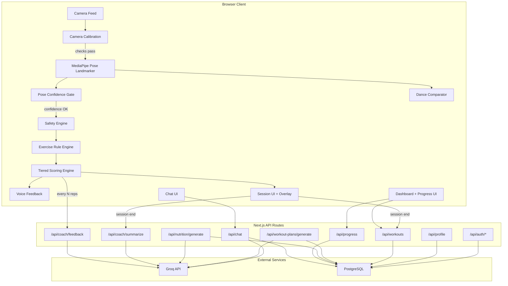
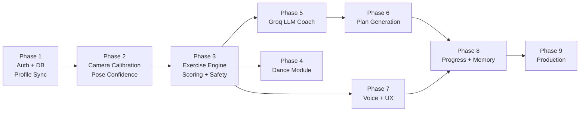

# AI Fitness and Dance Coach -- Definitive Implementation Plan

---

## 1. Current State Summary

The existing project is a **Next.js 15 (App Router)** app with:
- **Working**: Basic MediaPipe pose detection in browser, OpenAI chat (gpt-4o-mini), Drizzle schema with SQLite, shadcn/radix UI, seed data for exercises/achievements/dance styles, multi-step onboarding UI
- **Broken/Disconnected**: better-auth configured but **never wired to the UI** (no login page, no session usage), user identity is random `localStorage` IDs
- **Mocked/Stub**: Dashboard stats, progress history, achievements, workout plans, nutrition plans all use **hardcoded mock arrays or localStorage** -- not backed by the database
- **Missing Entirely**: Professional scoring model, exercise-specific rule engines, dance pose comparison, voice feedback, Groq LLM integration, workout plan generation, diet plan generation, real progress tracking, session summaries, dual feedback system, camera calibration, pose confidence handling, safety/contraindication engine

---

## 2. Gap Analysis (Knowledge Base vs. Current)

| KB Module | Current State | Gap |
|-----------|--------------|-----|
| 3.1 Live Pose Analysis | MediaPipe runs client-side, basic angle heuristics in [PoseAnalyzer.tsx](src/components/PoseAnalyzer.tsx) | No state-machine rep counting, no ROM/tempo/stability/symmetry scoring, no camera calibration, no confidence gating |
| 3.2 Exercise Coaching | PoseAnalyzer has presets for squat, pushup, plank, lunge, dance, warrior | No per-exercise rule engine with full form checks (KB sections 8.1-8.4), no bicep curls, no jumping jacks |
| 3.3 Dance Coaching | UI page exists at `/coach/dance`, dance styles seeded in DB | No reference routine playback, no pose comparison, no timing/segment scoring |
| 3.4 AI Chat Coach | OpenAI gpt-4o-mini chat works, persists to `chat_messages` | Not using Groq, no structured onboarding Q&A, no session-aware coaching, no coaching memory |
| 3.5 Workout Planning | Mock plans displayed in UI | No AI generation, no progression logic, no weekly splits, no warm-up/cool-down |
| 3.6 Diet Planning | Nutrition page with mock data | No AI meal generation, no macro calculation, no grocery lists, no personalization |
| 3.7 Progress Dashboard | Mock arrays (`mockWeightHistory`, etc.), localStorage | No real DB-backed tracking, no trend analysis, no coaching summaries |
| 3.8 Voice/UX Feedback | Not implemented | No browser speech synthesis, no rate-limited voice cues |
| Auth | better-auth configured in [config.ts](src/lib/auth/config.ts), not used by any page | No login/signup pages, no session-gated routes, no middleware |
| Database | SQLite + Drizzle schema in [schema.ts](src/db/schema.ts) exists with 14 tables | Schema covers basics but pages bypass it for localStorage/mocks; missing per-rep data, feedback events, dance routines tables |
| Backend | Express stub in [backend/server.js](backend/server.js) returning hardcoded `{ feedback: "Keep your back straight", accuracy: 75 }` | No real analysis, no LLM orchestration, no plan generation endpoints |

---

## 3. Architecture Decision: Backend Strategy

**Decision: Keep everything in Next.js API routes. Remove Express stub.**

Rationale:
- The real-time loop (pose analysis, scoring, feedback) runs entirely in the **browser** -- the backend is NOT in the hot path
- Backend handles only: auth, CRUD, LLM orchestration (Groq), plan generation, session persistence -- all standard request-response patterns
- Extracting to a separate FastAPI service is only justified later if we add: batch video analysis, multimodal model inference, or heavy async job queues
- This keeps deployment simple (single Vercel/similar deployment) and avoids premature architecture split

Action items:
- Remove [backend/](backend/) directory entirely
- Remove [src/app/api/analyze/route.ts](src/app/api/analyze/route.ts) (the proxy route)
- All pose analysis stays client-side; LLM-enhanced feedback goes through new `/api/coach/feedback` endpoint

---

## 4. Architecture Diagram



---

## Phase 1: Foundation (Auth, DB Wiring, Profile Sync)

**Goal**: Every user has a real identity; all data flows through the database, not localStorage.

### 1A. Wire Authentication to UI
- Create `/login` and `/signup` pages using better-auth's `signIn.email` / `signUp.email` from [src/lib/auth/client.ts](src/lib/auth/client.ts)
- Add Next.js middleware (`src/middleware.ts`) to protect `/dashboard`, `/coach/*`, `/workouts`, `/nutrition`, `/progress`, `/achievements`, `/settings` -- redirect unauthenticated users to `/login`
- Update [src/components/layout/AppLayout.tsx](src/components/layout/AppLayout.tsx): show real user name/email from `useSession()`, wire "Log out" to `signOut()`, show real streak count
- Update the landing page (`/`) to be a public marketing page; authenticated users redirect to `/dashboard`

### 1B. Sync Profile with Database
- Replace `useUserProfile` localStorage hook ([src/hooks/useUserProfile.ts](src/hooks/useUserProfile.ts)) with a React context/hook that reads/writes via `GET/POST /api/profile`
- Pass the real `session.user.id` (from better-auth) to ALL API calls -- replace every instance of `localStorage` random `user_${Date.now()}` IDs (used in [src/app/coach/chat/page.tsx](src/app/coach/chat/page.tsx) and elsewhere)
- Update [src/app/onboarding/page.tsx](src/app/onboarding/page.tsx) to POST profile to DB on completion
- Update [src/app/settings/page.tsx](src/app/settings/page.tsx) to read/write from the same API

### 1C. Replace All Mock Data with DB Queries
- **Dashboard** ([src/app/dashboard/page.tsx](src/app/dashboard/page.tsx)): Replace mock weekly data, heatmap, streak with real queries from `workout_sessions`, `progress_tracking`
- **Progress** ([src/app/progress/page.tsx](src/app/progress/page.tsx)): Replace `mockWeightHistory` etc. with real `progress_tracking` rows
- **Achievements** ([src/app/achievements/page.tsx](src/app/achievements/page.tsx)): Replace `mockAchievements` with `user_achievements` join query
- **Workout Plans** ([src/app/workout-plans/page.tsx](src/app/workout-plans/page.tsx)): Replace mock plans with `workout_plans` from DB
- **Nutrition** ([src/app/nutrition/page.tsx](src/app/nutrition/page.tsx)): Wire to `nutrition_plans` + `food_log` tables

### 1D. Remove Dead Code
- Delete [backend/](backend/) directory (Express stub)
- Delete [src/app/api/analyze/route.ts](src/app/api/analyze/route.ts) (proxy to stub)
- Delete [src/components/FormAnalyzer.tsx](src/components/FormAnalyzer.tsx) (orphan, never imported)
- Delete duplicate hook [src/lib/hooks/use-mobile.tsx](src/lib/hooks/use-mobile.tsx) (keep `src/hooks/use-mobile.ts`)

---

## Phase 2: Camera Calibration + Pose Confidence Layer

**Goal**: Ensure pose data quality BEFORE exercise analysis begins. Without this, even perfect scoring logic produces unreliable results.

### 2A. Pre-Session Camera Calibration
Add a setup screen (`src/components/SessionSetup.tsx`) that runs before exercise analysis starts:

- **Full-body visibility check**: Verify key landmarks (per exercise, see Appendix D) detected with confidence > 0.6
- **Lighting adequacy**: Average landmark confidence across 10 frames; warn if < 0.65
- **Distance guidance**: Measure shoulder-width-to-frame-width ratio; guide "step back" / "step closer"
- **Camera angle guidance per exercise**:
  - Push-ups: side view preferred (detect via shoulder-hip-ankle horizontal alignment)
  - Squats/lunges/jumping jacks/bicep curls: front-facing full-body
  - Dance: front-facing full-body, minimum 80% body visible
- **Left/right orientation normalization**: Detect which side faces camera; mirror landmark mapping if needed
- **Ready gate**: Session starts only when all checks pass for 3+ consecutive seconds
- Visual overlay shows a silhouette outline of the expected body position for the selected exercise

### 2B. Runtime Pose Confidence and Error Handling
Create `src/lib/pose/confidence.ts`:

- **Landmark confidence too low** (avg < 0.5 for 1s): pause scoring, show "Adjust your position" overlay
- **Body partially out of frame** (key landmarks missing): suspend rep counting, preserve rep state, show "Step back into frame"
- **Camera lost** (no video frames for > 2s): show recovery prompt with "Reconnect Camera" button
- **Jitter detection**: Apply exponential moving average (EMA) smoothing on landmark positions before passing to rule engines; configurable alpha (0.3 default)
- **FPS degradation** (< 15 fps for 5s): reduce MediaPipe `modelComplexity` from 1 to 0, notify user

These checks wrap the existing `pose.onResults` callback in [PoseAnalyzer.tsx](src/components/PoseAnalyzer.tsx) and gate whether landmarks are forwarded to the exercise rule engine.

---

## Phase 3: Exercise Coaching Engine (Core Differentiator)

**Goal**: Professional-grade, per-exercise rule engines with tiered scoring and injury-aware safety.

### 3A. Modular Exercise State Machines + Rep Counters
Refactor [src/components/PoseAnalyzer.tsx](src/components/PoseAnalyzer.tsx) (currently 1400 lines, monolithic) into:

- `src/lib/pose/types.ts` -- shared types (`ExerciseLandmarks`, `RepEvent`, `FormCheck`, `ExercisePhase`)
- `src/lib/pose/angles.ts` -- extract existing `calculateAngle()`, add `calculateDistance()`, `calculateSlope()`
- `src/lib/pose/exercises/bicep-curl.ts` -- KB 8.2: elbow stability, shoulder compensation, full contraction/extension, wrist control, tempo symmetry, body swinging
- `src/lib/pose/exercises/push-up.ts` -- KB 8.1: back alignment, elbow angle, chest depth, head/neck, pace, lockout, incomplete reps, asymmetry
- `src/lib/pose/exercises/jumping-jack.ts` -- KB 8.3: arm raise height, leg spread, coordination, rhythm, landing control, torso stability
- `src/lib/pose/exercises/lunges.ts` -- KB 8.4: knee alignment, knee travel, rear knee depth, torso posture, step length, balance, left-right asymmetry

Each module exports the same interface:

```typescript
interface ExerciseEngine {
  detectPhase(landmarks: NormalizedLandmark[]): ExercisePhase;
  countRep(prevPhase: ExercisePhase, currentPhase: ExercisePhase): RepEvent | null;
  evaluateForm(landmarks: NormalizedLandmark[]): FormCheckResult[];
  getCorrections(formChecks: FormCheckResult[]): Correction[];
  cameraRequirement: CameraPosition; // "front" | "side" | "front_preferred"
}
```

State machine: `IDLE -> ECCENTRIC -> BOTTOM -> CONCENTRIC -> TOP -> rep counted`

### 3B. Tiered Scoring Model

Create `src/lib/pose/scoring.ts` with three scoring granularities:

**Live (every frame, < 16ms budget):**
- Posture warnings (safety thresholds exceeded)
- Current exercise phase indicator
- Safety alerts (dangerous angles)

**Per-Rep (computed on rep completion):**
- Form accuracy score (joint angles vs ideal ranges per exercise)
- Range of motion score (actual vs target ROM percentage)
- Tempo score (phase duration vs target duration)

**Per-Set / Per-Session (computed on set/session end):**
- Consistency score (rep-to-rep variance in form, ROM, tempo)
- Symmetry score (left vs right comparison, averaged across reps)
- Endurance/fatigue degradation (score trend from first rep to last)
- Stability score (landmark jitter averaged across set)

Composite score per exercise with configurable weights:

```typescript
interface ExerciseWeights {
  form: number;        // default 0.25
  rom: number;         // default 0.20
  tempo: number;       // default 0.15
  stability: number;   // default 0.10
  symmetry: number;    // default 0.10
  consistency: number; // default 0.10
  safety: number;      // default 0.10
}
```

Final score: weighted average, 0-100.

### 3C. Safety and Contraindication Engine

Create `src/lib/pose/safety.ts`:

- **Injury-aware exercise filtering**: Before session start, check `user_profiles.injuries` and `user_profiles.painPoints` against exercise contraindications
  - Knee injury -> warn/block lunges, reduce squat ROM target
  - Shoulder injury -> warn/block push-ups, suggest wall push-ups from `exercises.modifications`
  - Back injury -> reduce all forward-lean tolerance thresholds
- **Live safety rules** (highest priority, override ALL other feedback):
  - Knee valgus (inward collapse) > 15 degrees: immediate "Stop - knees collapsing inward"
  - Hyperextension of any joint beyond safe threshold: immediate warning
  - Neck hyperextension during push-ups: immediate "Look at the floor"
- **Regression suggestions**: When user scores < 50 on safety for 3+ consecutive reps, suggest easier modification from `exercises.modifications` JSON column
- **ROM target adjustment**: For users with injuries, automatically reduce target ROM by configurable percentage (default 20%)

### 3D. Dual Feedback System (KB Section 10)

- **Rule-based layer** (`src/lib/feedback/rule-engine.ts`): Immediate, deterministic corrections emitted by exercise modules. Examples: "Straighten your back", "Lower deeper", "Slow down the upward phase"
- **LLM layer** (`src/lib/feedback/llm-coach.ts`): After every N reps or end-of-set, send accumulated metrics to Groq via `POST /api/coach/feedback` for natural-language coaching interpretation. Examples: "Your form drops near the bottom of the rep. Focus on keeping your core tighter as you descend."
- Priority logic: `safety > posture correction > form guidance > motivation > rep count announcement`
- Create `src/lib/feedback/priority-queue.ts` to manage feedback ordering

---

## Phase 4: Dance Coaching Module

**Goal**: One dance style (hip-hop beginner) with pose comparison and scoring.

### 4A. Reference Routine Data Pipeline

**Decision: Handcrafted from recorded video.**

Pipeline:
1. Record a choreographer performing the routine using the same MediaPipe setup in a browser
2. Extract landmark snapshots at 10fps using a utility script (`scripts/extract-dance-landmarks.ts`)
3. Segment into timed checkpoints (pose + timestamp) manually via JSON editing
4. Store as curated JSON assets in `public/routines/hip-hop-beginner.json`
5. Reference in `dance_routines` table (new table, see Appendix A)

This avoids needing an admin UI for V1 while keeping the data format clean for future expansion (uploaded reference clips, multiple routines).

### 4B. Pose Comparison Engine
Create `src/lib/pose/dance/comparator.ts`:
- Normalize landmarks to body-relative coordinates (hip-center origin, shoulder-width scale)
- Compute cosine similarity between user pose vector and reference pose vector per checkpoint
- Score timing alignment (how close user hits the pose to the checkpoint timestamp)
- Detect missed transitions (similarity drops below 0.4 for > 2 seconds)
- Segment-wise feedback + overall dance performance score

### 4C. Dance Session UI
Update [src/app/coach/dance/page.tsx](src/app/coach/dance/page.tsx):
- Side-by-side view: reference skeleton animation + user camera feed
- Real-time pose similarity gauge (percentage)
- Segment progress bar with checkpoint markers
- Post-routine score breakdown by segment
- "Try again" and "Next routine" flow

---

## Phase 5: AI Chat Coach + LLM Integration

**Goal**: Context-aware conversational coach using Groq API.

### 5A. Switch to Groq API
- Replace OpenAI in [src/app/api/chat/route.ts](src/app/api/chat/route.ts) with `groq-sdk` package
- Model: `llama-3.3-70b-versatile` (fast, good for conversational coaching)
- Add `GROQ_API_KEY` to [.env.example](.env.example)
- Keep fallback to `gpt-4o-mini` if `GROQ_API_KEY` is not set (graceful degradation)

### 5B. Deep Context System Prompt
Build a rich system prompt that includes:
- User profile: goals, injuries, pain points, fitness level, equipment, dietary preferences
- Last 3 session scores and scoring breakdowns
- Current workout plan adherence percentage
- Recent injuries/pain reported in chat
- Progress trends (weight change direction, average score improvement)
- Coaching tone preference from `user_profiles.coachingTone`

The coach should be able to: explain exercise mistakes, suggest modifications for injuries, motivate, summarize weekly progress, answer fitness and diet questions, recommend rest days.

### 5C. Structured Onboarding via Chat
- If `user_profiles.onboardingCompleted === false`, chat drives structured Q&A to collect all KB section 12 inputs (age, height, weight, goals, injuries, pain points, equipment, dietary preferences, budget, cuisine preference, sleep, workout time)
- Responses are parsed and saved to `user_profiles` via `POST /api/profile`
- This provides an alternative to the form-based onboarding at `/onboarding`

### 5D. Session-Aware Coaching
- After workout sessions, auto-generate a coaching summary via `POST /api/coach/summarize`
- Chat can reference specific session data ("Your form dropped on rep 8, focus on keeping your back straight during the eccentric phase")
- Coaching memory stored in `chat_sessions.summary` and `chat_sessions.context` (new columns)

---

## Phase 6: Workout + Diet Plan Generation

**Goal**: AI-generated personalized plans, not mock data.

### 6A. Workout Plan Generation
Create `POST /api/workout-plans/generate` endpoint:
- Input: fetches `user_profiles` server-side (goals, fitness level, injuries, equipment, available time per day, workout frequency, intensity preference)
- LLM generates structured JSON: weekly split, daily exercises, sets/reps/rest durations, warm-up suggestions, cool-down suggestions
- Output stored in `workout_plans` + associated `workout_exercises`
- Support progression rules (increase reps/weight weekly) and regression rules (reduce load on pain/low fitness)
- Recovery advice included for rest days

### 6B. Diet Plan Generation (Structured Output)
Create `POST /api/nutrition/generate` endpoint -- LLM generates structured JSON (not free text):

```typescript
interface GeneratedNutritionPlan {
  dailyCalories: number;
  macros: { proteinGrams: number; carbsGrams: number; fatGrams: number };
  meals: {
    type: "breakfast" | "lunch" | "dinner" | "snack";
    name: string;
    ingredients: string[];
    calories: number;
    protein: number;
    carbs: number;
    fat: number;
    prepTime: number;
    budgetTier: "low" | "medium" | "high";
    cuisineTag: string;
  }[];
  hydration: { dailyLiters: number; reminders: string[] };
  groceryList: { item: string; quantity: string; estimatedCost: string }[];
  mealTimingAdvice: string;
  notes: string;
}
```

Prompted with JSON schema + `response_format: { type: "json_object" }` for parseable output. Stored in `nutrition_plans` table.

Input factors: goal, body profile, injuries/inflammation, activity level, budget tier, cuisine preference, vegetarian/non-vegetarian, allergies, meal timing preference.

### 6C. Plan Adaptation
- Plans are re-generatable based on updated profile or progress data
- Weekly check-in prompt from chat coach to assess adherence and suggest adjustments
- Coach proactively suggests plan update after significant profile changes (weight loss milestone, new injury reported)

---

## Phase 7: Voice Feedback + Real-Time UX

**Goal**: Voice-based coaching cues during live sessions with polished UI.

### 7A. Browser Speech Synthesis
Implement `src/lib/feedback/voice.ts` using `window.speechSynthesis` API:
- Rate-limited to max one cue per 4 seconds to avoid overload
- Priority queue: `safety > form correction > encouragement > rep count`
- Voice on/off toggle in session UI
- Future: user-selectable voice (male/female) via `SpeechSynthesisVoice` selection

### 7B. Session Overlay UX
Enhance [src/app/coach/workout/page.tsx](src/app/coach/workout/page.tsx):
- **Pre-session**: Camera position guide overlay showing ideal framing for selected exercise (from Appendix D)
- Skeleton overlay on camera feed (already partially built, keep and enhance with score-based coloring)
- Real-time score gauge (ring/arc)
- Rep counter with per-rep quality indicator (green/yellow/red dot per rep)
- Text overlay for current correction
- Timer + rest period indicator between sets
- Voice on/off toggle
- Session summary screen on completion

### 7C. Session Persistence
On session end, POST full session data to `POST /api/workouts`:
- Per-rep scores via `exercise_reps` table (new)
- Corrections triggered via `session_feedback_events` table (new)
- Composite score breakdown, fatigue curve, total reps, avg rep duration
- Generate and store LLM session summary via `POST /api/coach/summarize`

---

## Phase 8: Progress Tracking + Coaching Memory

**Goal**: Longitudinal tracking with trend analysis and coaching context.

### 8A. Progress APIs
Create `GET/POST /api/progress` endpoints backed by `progress_tracking` table.
Track: weight, body fat, measurements, workout frequency, average scores per exercise, streaks, adherence percentage.

### 8B. Dashboard with Real Data
Update [src/app/dashboard/page.tsx](src/app/dashboard/page.tsx):
- Real streak calculation from `workout_sessions` (count consecutive days with completed sessions)
- Weekly/monthly charts using `recharts` (already a dependency) with actual session data
- Score trend lines per exercise over time
- Adherence percentage (planned workouts vs completed)
- Recent session summaries

### 8C. Achievement System
- Create achievement evaluation logic triggered after each session
- Examples: "Complete 10 workouts", "Score 90+ on push-ups", "7-day streak", "First dance session"
- Auto-award via `user_achievements` table
- Display real badges on `/achievements` page

### 8D. Coaching Memory
- Store coaching summaries and key decisions in `chat_sessions` table
- LLM system prompt includes last 5 coaching summaries for continuity
- Progress milestones trigger proactive coach messages ("Congratulations on your 10th session!")
- Coach remembers injury reports and exercise preferences across sessions

---

## Phase 9: Production Hardening

**Goal**: Production-ready quality, security, and performance.

### 9A. Database: PostgreSQL Migration
- Switch from SQLite to PostgreSQL (Neon recommended for serverless)
- Update [drizzle.config.ts](drizzle.config.ts) and [src/db/schema.ts](src/db/schema.ts) to use `pg-core` instead of `sqlite-core`
- Migrate seed data from [src/db/seed.ts](src/db/seed.ts)
- Update `DATABASE_URL` in `.env.example`

### 9B. Security + Privacy
- Camera consent screen with clear privacy language ("Video never leaves your device. Only pose landmark coordinates are processed.")
- No raw video stored; only pose landmarks and scores persisted
- Zod validation schemas on ALL API inputs (every POST endpoint)
- Rate limiting on LLM endpoints (10 req/min per user for chat, 5 req/min for plan generation)
- CSRF protection (already has `CSRF_SECRET` in env)

### 9C. Performance + Resilience
- Graceful FPS degradation (reduce `modelComplexity` from 1 to 0 when fps < 15)
- Lazy-load MediaPipe models (only download when user opens a coach page)
- Skeleton rendering at reduced fidelity on weak devices
- Error boundaries for camera/pose failures with user-friendly recovery prompts
- Offline-capable session: queue session data in IndexedDB if network is unavailable, sync on reconnect

### 9D. UI Polish
- Responsive design audit across mobile, tablet, desktop
- Loading states, empty states, error states for every page
- Consistent dark/light theme (partially implemented, complete it)
- Accessibility audit: keyboard navigation, screen reader support, ARIA labels
- Smooth transitions between session states (calibrating -> active -> paused -> completed)

---

## Appendix A: Schema Definitions

### New Tables to Add

**`exercise_reps`** -- per-rep granular scoring data

| Column | Type | Description |
|--------|------|-------------|
| id | text PK | nanoid |
| sessionId | text FK -> workout_sessions.id | Parent session |
| exerciseId | text FK -> exercises.id | Which exercise |
| repNumber | integer | 1-indexed rep number |
| phase | text | "eccentric", "concentric", "isometric" |
| formScore | integer | 0-100 |
| romScore | integer | 0-100 |
| tempoScore | integer | 0-100 |
| safetyScore | integer | 0-100 |
| corrections | text (JSON) | e.g. ["Keep back straight", "Lower deeper"] |
| durationMs | integer | Time for this rep in ms |
| timestamps | text (JSON) | { startMs, bottomMs, endMs } |
| createdAt | timestamp | |

Read/write: session persistence on session end (Phase 7C)

**`session_feedback_events`** -- timestamped feedback log

| Column | Type | Description |
|--------|------|-------------|
| id | text PK | nanoid |
| sessionId | text FK -> workout_sessions.id | Parent session |
| timestamp | integer | ms since session start |
| type | text | "safety", "form", "motivation", "llm" |
| message | text | The feedback text shown |
| severity | text | "critical", "warning", "info" |
| source | text | "rule_engine", "llm_coach" |
| createdAt | timestamp | |

Read/write: feedback engine during live session

**`dance_routines`** -- reference routine landmark data

| Column | Type | Description |
|--------|------|-------------|
| id | text PK | nanoid |
| danceStyleId | text FK -> dance_styles.id | Parent style |
| name | text | e.g. "Hip-Hop Beginner - Routine 1" |
| durationMs | integer | Total routine length |
| checkpoints | text (JSON) | [{ timestampMs, landmarks: [...], label }] |
| difficulty | text | beginner, intermediate, advanced |
| musicUrl | text | Path to audio file |
| thumbnailUrl | text | Preview image |
| createdAt | timestamp | |

Read/write: seed script writes; dance comparator reads

### Columns to Add to Existing Tables

**`workout_sessions`** -- add:
- `compositeScore` integer (0-100)
- `scoringBreakdown` text/JSON ({ form, rom, tempo, stability, symmetry, consistency, endurance, safety })
- `summary` text (LLM-generated)
- `exerciseType` text (specific exercise used)
- `totalReps` integer
- `avgRepDurationMs` integer
- `fatigueCurve` text/JSON (array of per-rep scores)

**`workout_exercises`** -- add:
- `romScore`, `tempoScore`, `stabilityScore`, `symmetryScore`, `consistencyScore`, `safetyScore` (all integer)
- `corrections` text/JSON (aggregated corrections)

**`user_profiles`** -- add:
- `painPoints` text/JSON (e.g. ["knees", "lower_back", "wrists"])
- `sleepHours` real
- `budgetTier` text ("low", "medium", "high")
- `cuisinePreference` text ("indian", "mediterranean", etc.)
- `coachingTone` text ("strict", "friendly", "motivational")

**`chat_sessions`** -- add:
- `summary` text (LLM coaching summary)
- `context` text/JSON (snapshot of user profile + recent scores)

**`nutrition_plans`** -- add:
- `hydrationLiters` real
- `mealTiming` text/JSON
- `groceryList` text/JSON
- `cuisineType` text
- `budgetTier` text

---

## Appendix B: API Contracts

### POST /api/profile
Auth: Required (session user ID extracted from better-auth)

```typescript
// Request body
{ userId: string, age?: number, gender?: string, height?: number, weight?: number,
  targetWeight?: number, fitnessLevel?: string, goals?: string[], injuries?: string[],
  painPoints?: string[], equipmentAccess?: string[], dietaryPreferences?: string[],
  allergies?: string[], workoutFrequency?: number, workoutDuration?: number,
  cuisinePreference?: string, budgetTier?: string, coachingTone?: string }
// 200: { message: "Profile updated successfully" }
// 400: { error: "User ID required" }
```

### POST /api/workouts
Auth: Required

```typescript
// Request body
{ userId: string, type: string, exerciseType: string, duration: number,
  caloriesBurned: number, totalReps: number, compositeScore: number,
  scoringBreakdown: { form: number, rom: number, tempo: number, stability: number,
    symmetry: number, consistency: number, endurance: number, safety: number },
  fatigueCurve: number[],
  exercises: [{ exerciseId: string, sets: number, reps: number, formScore: number,
    romScore: number, tempoScore: number, safetyScore: number, corrections: string[] }],
  repData: [{ repNumber: number, formScore: number, romScore: number, tempoScore: number,
    safetyScore: number, corrections: string[], durationMs: number }] }
// 200: { message: "Workout created successfully", sessionId: string }
```

### POST /api/workout-plans/generate
Auth: Required

```typescript
// Request: { userId: string } (profile fetched server-side)
// 200: { plan: { name, description, goal, duration, daysPerWeek, difficulty,
//   weeklySchedule: [{ day, focus, exercises: [{ exerciseId, sets, reps, restSeconds }],
//     warmUp: string[], coolDown: string[] }],
//   progressionRules: string[], regressionRules: string[] } }
// 503: { error: "LLM service unavailable", fallback: "Try again in a moment" }
```

### POST /api/nutrition/generate
Auth: Required

```typescript
// Request: { userId: string } (profile fetched server-side)
// 200: { plan: GeneratedNutritionPlan }  // see Phase 6B interface
// 503: { error: "LLM service unavailable" }
```

### POST /api/chat
Auth: Required

```typescript
// Request: { userId: string, message: string }
// 200: { message: string, tokens: number }
// 503: { error: "Chat service unavailable" }
```

### POST /api/coach/summarize
Auth: Required

```typescript
// Request: { userId: string, sessionId: string }
// 200: { summary: string, keyInsights: string[], nextSessionFocus: string[] }
```

### POST /api/coach/feedback
Auth: Required

```typescript
// Request: { userId: string, exerciseType: string, repsSoFar: number,
//   recentScores: { form: number, rom: number, tempo: number, safety: number }[],
//   currentIssues: string[] }
// 200: { feedback: string, priority: "safety" | "form" | "motivation" }
```

### GET /api/progress?userId=X
Auth: Required

```typescript
// 200: { entries: [{ date, weight, bodyFat, measurements, exerciseScores }],
//   streak: number, totalSessions: number, avgScore: number }
```

**Validation**: All POST endpoints use Zod schemas. Missing required fields return 400 with field-level errors.
**Failure modes**: LLM endpoints return 503 if Groq is unreachable, with a user-friendly fallback message.

---

## Appendix C: Exercise Scoring Formulas and Thresholds

### Bicep Curl

| Check | Ideal | Warning | Fail |
|-------|-------|---------|------|
| Elbow angle at contraction | < 40 deg | 40-60 deg | > 60 deg |
| Elbow angle at extension | > 155 deg | 130-155 deg | < 130 deg |
| Shoulder compensation (elbow drift) | < 5cm | 5-10cm | > 10cm |
| Body swing (hip lateral movement) | < 3cm | 3-6cm | > 6cm |
| Wrist deviation from neutral | < 10 deg | 10-20 deg | > 20 deg |

### Push-Up

| Check | Ideal | Warning | Fail |
|-------|-------|---------|------|
| Elbow angle at bottom | 80-100 deg | 60-80 or 100-120 | < 60 or > 120 |
| Back alignment (shoulder-hip-ankle) | > 170 deg | 155-170 deg | < 155 deg |
| Head/neck angle | Neutral (inline) | < 15 deg deviation | > 15 deg |
| Elbow flare from body | 30-50 deg | 20-30 or 50-70 | < 20 or > 70 |
| Lockout at top | > 165 deg elbow | 150-165 | < 150 |

### Squat

| Check | Ideal | Warning | Fail |
|-------|-------|---------|------|
| Knee angle at bottom | 70-100 deg | 100-120 deg | > 120 deg |
| Torso angle | 60-80 deg | 50-60 or 80-100 | < 50 or > 100 |
| Knee valgus | < 5 deg inward | 5-15 deg | > 15 deg (SAFETY STOP) |
| Symmetry (L-R knee diff) | < 5 deg | 5-15 deg | > 15 deg |

### Jumping Jack

| Check | Ideal | Warning | Fail |
|-------|-------|---------|------|
| Arm raise (wrist above shoulder) | > 30 deg above | 0-30 deg above | Below shoulder |
| Leg spread (ankle-to-ankle) | > 1.5x hip width | 1.2-1.5x | < 1.2x |
| Rhythm consistency (timing variance) | < 15% | 15-30% | > 30% |
| Torso stability (hip sway) | < 5cm | 5-10cm | > 10cm |

### Lunge

| Check | Ideal | Warning | Fail |
|-------|-------|---------|------|
| Front knee angle | 85-95 deg | 75-85 or 95-110 | < 75 or > 110 |
| Front knee past toe | Behind/over toe | 0-3cm past | > 3cm past (SAFETY) |
| Rear knee depth | 5-15cm from floor | 15-25cm | > 25cm |
| Torso upright (lean) | < 5 deg forward | 5-15 deg | > 15 deg |

### Tempo Targets

| Exercise | Eccentric | Pause | Concentric |
|----------|-----------|-------|------------|
| Bicep Curl | 2.0s | 0.5s | 1.5s |
| Push-Up | 2.0s | 0.3s | 1.0s |
| Squat | 2.5s | 0.5s | 1.5s |
| Lunge | 2.0s | 0.5s | 1.5s |
| Jumping Jack | 0.5s | 0s | 0.5s |

---

## Appendix D: Camera Calibration Requirements per Exercise

| Exercise | Preferred View | Min Body Visible | Key Landmarks Required | Distance Guide |
|----------|---------------|-----------------|----------------------|----------------|
| Push-Up | Side | 90% | shoulder, elbow, wrist, hip, ankle | Full body |
| Bicep Curl | Front or 45-deg | 70% | shoulder, elbow, wrist, hip | Waist-up minimum |
| Squat | Front | 95% | hip, knee, ankle, shoulder (both) | Full body + 10% margin |
| Lunge | Front or 45-deg | 95% | hip, knee, ankle, shoulder (both) | Full body + 10% margin |
| Jumping Jack | Front | 100% | All upper + lower body | Full body + 15% margin |
| Dance | Front | 100% | All 33 landmarks | Full body + 20% margin |

---

## Implementation Priority and Dependencies



**Critical path**: Phases 1 -> 2 -> 3 -> 5 -> 6 -> 8 -> 9

**Parallelizable**: Phase 4 (dance) and Phase 7 (voice/UX) can run alongside Phase 5-6

**Estimated scope**: ~50-60 files modified or created. 3 new DB tables, 5 existing tables extended, ~15 new `src/lib/pose/` modules, ~5 new API routes, 2 new pages (login/signup), 1 new component (SessionSetup).
